

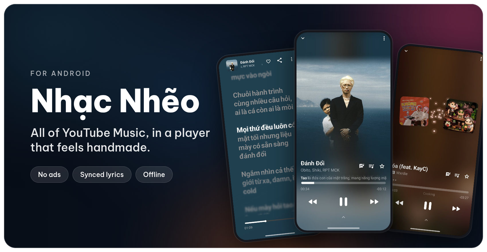

# Nhạc Nhẽo

**All of YouTube Music, in a player that feels handmade.**
No ads. Music keeps playing with the screen off. Lyrics that light up word by word, translated into your language.

 

 
 

Installs next to the official SimpMusic app and keeps its own data.

 

## ✨ Why you'd want it

- ⚡ **Music starts fast.** Tap to sound went from 3.10 s to 1.29 s on Wi-Fi, and from 4.40 s to 2.12 s on mobile data.
- 🎨 **Three players, your pick.** Classic, Material 3 Expressive, or an Apple Music style with art that melts into the page.
- 💿 **A crossfade you can see.** While two songs blend, their covers sit side by side and sparks of each cover's colour drift between them.
- 🎤 **Lyrics done properly.** Synced word by word, romanized (pinyin and more), and AI translations written to be sung, not word-for-word.
- ✍️ **Lyrics wrong? Fix them.** Pick another source for that one song, turn them off, or tap along to time them yourself.
- 🎧 **Serious audio.** Up to 256 kbps with YouTube Premium, a ten-band equalizer, AutoEq headphone profiles, crossfade, DJ-style transitions.
- 📥 **Offline and everywhere.** Downloads, SponsorBlock, Spotify Canvas, Google Cast, and song recognition from the search bar.
- 🚗 **Made for real life.** Car mode with a self-filling offline library, a car LED strip that follows the album art, and music that follows me from phone to phone.

<table>
<tr>
<td width="33%" align="center">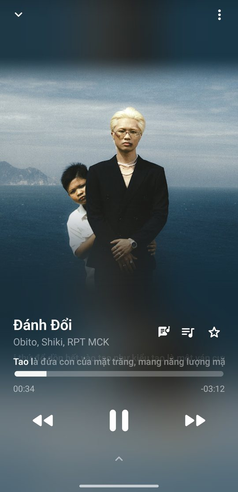 <b>Art that melts into the page</b></td>
<td width="33%" align="center">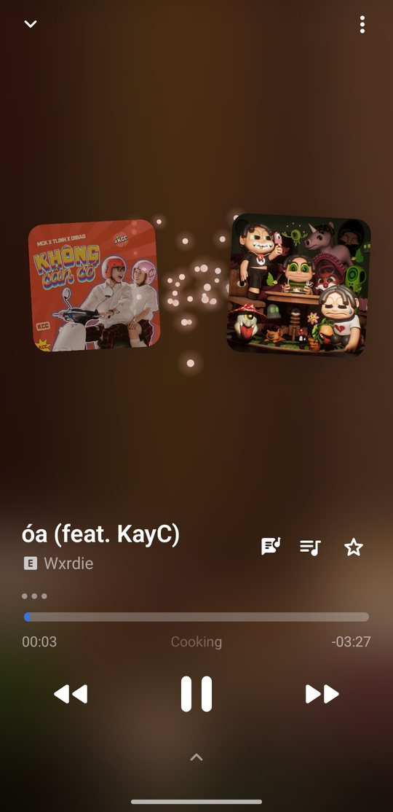 <b>Watch one song become the next</b></td>
<td width="33%" align="center">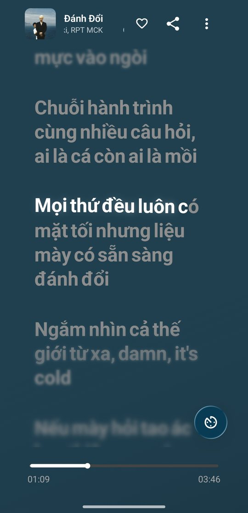 <b>Lyrics you can sing along to</b></td>
</tr>
</table>

Credit where it's due: the app itself, streaming, downloads, the equalizer, Cast, song recognition and much more come from <a href="https://github.com/maxrave-dev/SimpMusic">SimpMusic by maxrave-dev</a> and its contributors. What I added is listed in <a href="#under-the-hood">Under the hood</a>.

 

## 📲 Install

1. Open this page **on your Android phone** and tap **[Download](https://github.com/baotrq/simpmusic-bao-showcase/releases/latest/download/SimpMusic-Bao.apk)**.
2. Open the downloaded `SimpMusic-Bao.apk`, from the notification or from **Files → Downloads**.
3. If asked, allow installing from this source, then go back.
4. Tap **Install**. If Google Play Protect warns you, choose **More details → Install anyway**. It warns because this build isn't from the Play Store.
5. Open **Nhạc Nhẽo**. That's it: no account needed to start listening.

<b>🇻🇳 Cách cài bằng tiếng Việt</b>

 

1. Mở trang này **trên điện thoại Android** và bấm **[tải về](https://github.com/baotrq/simpmusic-bao-showcase/releases/latest/download/SimpMusic-Bao.apk)**.
2. Khi tải xong, mở file `SimpMusic-Bao.apk` (trong thông báo, hoặc ứng dụng **Tệp / Files → Tải xuống**).
3. Nếu điện thoại hỏi, chọn **Cài đặt** → bật **Cho phép từ nguồn này**, rồi quay lại.
4. Bấm **Cài đặt**. Nếu Google Play Protect cảnh báo, chọn **Thêm chi tiết → Vẫn cài đặt**.
5. Mở ứng dụng **Nhạc Nhẽo** là nghe được ngay, không cần tài khoản.

Muốn đổi ngôn ngữ: **Cài đặt → Giao diện → Ngôn ngữ**.

The button gets the arm64 build, which fits most phones. If it won't install, use the <code>universal</code> file from <a href="https://github.com/baotrq/simpmusic-bao-showcase/releases/latest">the latest release</a>; it runs on any device but is larger.

 

## 🧭 Quick guide

All of this lives in **Settings** (the gear on Home).

### Sign in, if you want your own music

**Accounts & sync → YouTube Account → Add an account.** You get your own Home, playlists and likes. You can skip this and just search and play. Your sign-in stays on your phone: there is no server of mine involved.

### Make it look like you

<table>
<tr>
<td width="62%" valign="top">

**Appearance → Now Playing style** opens real previews; tap one to apply it. **Lyrics style** sits right next to it. The Apple Music looks need Android 12 or newer.

**Appearance → Language** switches the app's language.

The player opens in the Classic style, so try the others: the Apple Music one is what I use.

</td>
<td width="38%" align="center">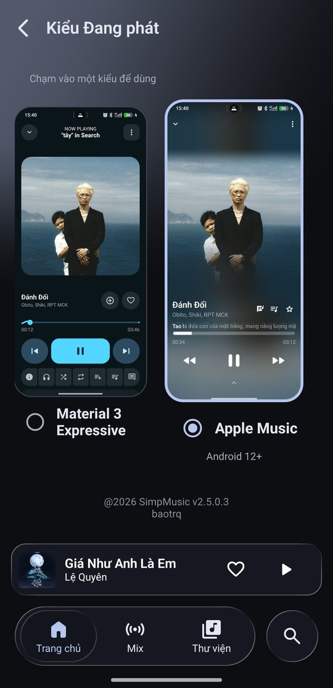</td>
</tr>
</table>

<table>
<tr>
<td width="33%" align="center">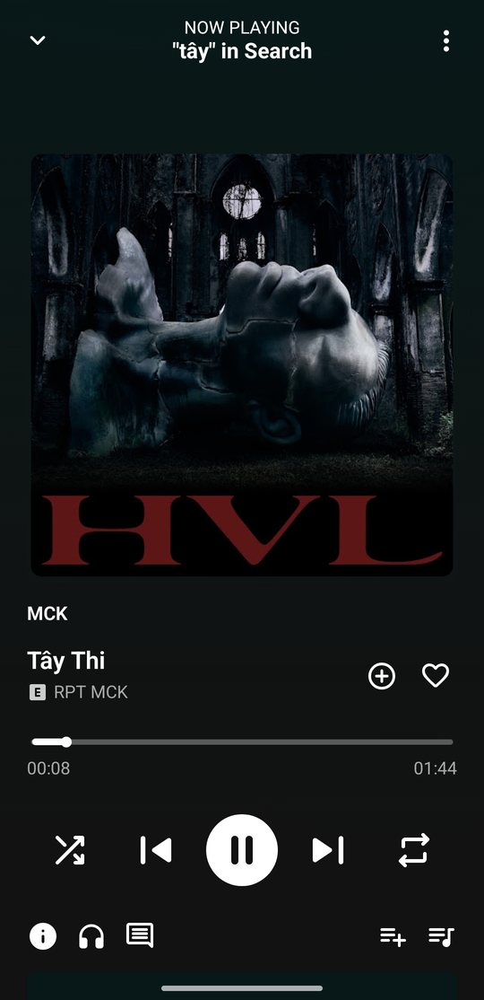 <b>Classic</b></td>
<td width="33%" align="center">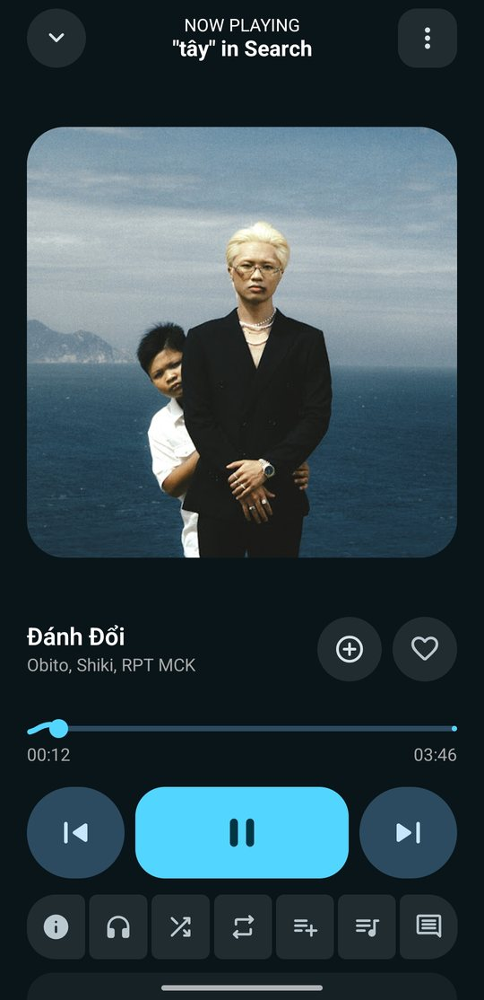 <b>Material 3 Expressive</b></td>
<td width="33%" align="center"> <b>Apple Music</b></td>
</tr>
</table>

### Get the best sound

<table>
<tr>
<td width="38%" align="center">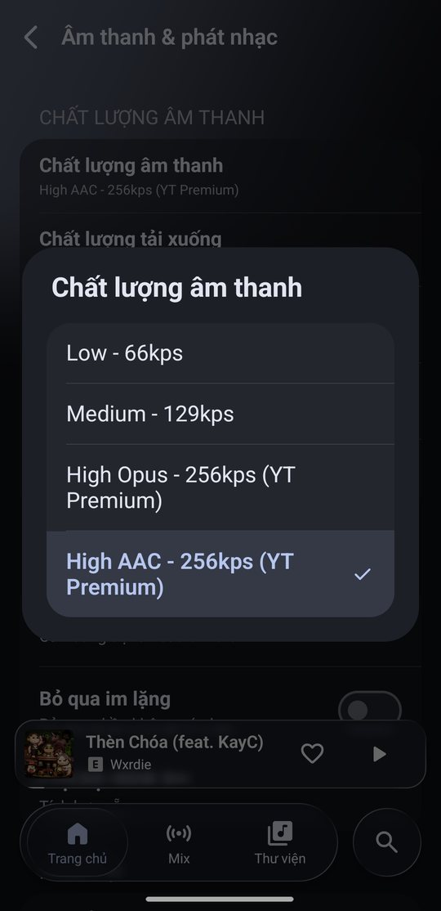</td>
<td width="62%" valign="top">

In **Audio & playback**:

- **Quality**: the 256 kbps options need YouTube Premium; everyone can pick up to Medium
- **Crossfade**: turn it on to get the two-cover animation, in the Apple Music style
- **Equalizer**: draw a curve, pick a preset, or import a profile for your exact headphones

</td>
</tr>
</table>

### Lyrics

- **Translate them:** add your own Gemini or OpenAI-compatible key under **Lyrics & AI → Your AI API Key**, then turn on **Use AI Lyric Translation** and set **Translation Language**. Each new translation uses your key.
- **Wrong lyrics?** In the player, tap **⋯ → Lyrics** to pick another source for that song, turn lyrics off for it, or use **Tap along**: the song restarts and you tap as each line begins.

### Stay up to date

<table>
<tr>
<td width="62%" valign="top">

**About → Check for new build** finds the newest version and installs it over the old one, keeping your data. The app doesn't check by itself, so look in here now and then.

Before changing phones or reinstalling, save your library with **Storage & backup**, and restore from the same place.

</td>
<td width="38%" align="center">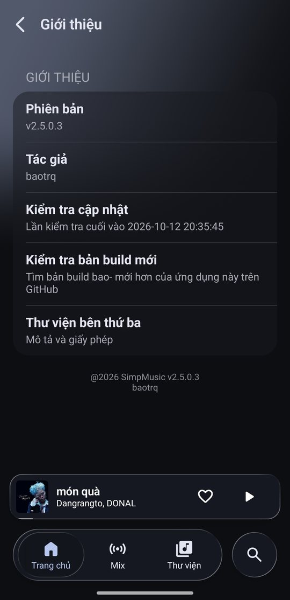</td>
</tr>
</table>

<b>Extras for tinkerers</b>

 

- **Continue on another phone:** needs your own free [Cloudflare Worker](https://github.com/baotrq/SimpMusic/tree/main/scripts/playback-sync-worker), then fill in **Accounts & sync → Playback sync**. It stays off until you do, and nothing is sent anywhere before that.
- **Car mode:** under **Developer option**. Keeps your songs offline and loads faster, using more data and storage.
- **LED strip:** inside Car mode, for Bluetooth `LEDDMX` controllers only.

> [!NOTE]
> This is an unofficial, personal build, not affiliated with YouTube, Google or the SimpMusic team, and it's provided as is. It uses YouTube's unofficial API, which can change at any time, and signing in with your account is your own call. Found a bug in this build? Tell me, not the SimpMusic team.

 

## 🛠️ Under the hood: what I built

> [!NOTE]
> **SimpMusic** is a FOSS YouTube Music client by [maxrave-dev](https://github.com/maxrave-dev) and its contributors (GPL-3.0).
> This part shows only **what I changed in my fork**: 39 commits across the app and its `core` module, October 12 – November 6, 2026.
> All of the fork's code is public in [baotrq/SimpMusic](https://github.com/baotrq/SimpMusic/tree/main) and [baotrq/core](https://github.com/baotrq/core/tree/main).

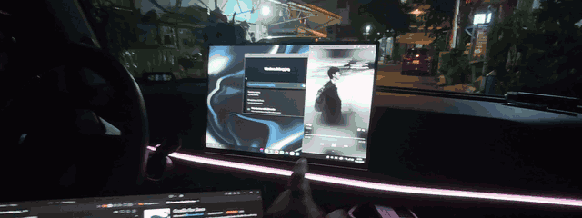

Real footage: the dash strip goes white for a black-and-white cover, then pink, red and blue as the covers change.

<table>
<tr>
<td width="33%" align="center">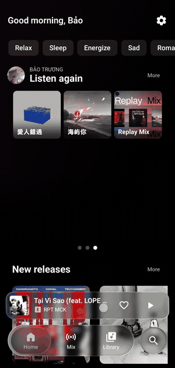 <b>Grows out of the mini bar</b></td>
<td width="33%" align="center"> <b>Swipe between songs</b></td>
<td width="33%" align="center">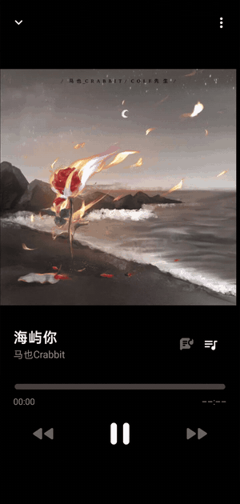 <b>Romanized + translated lyrics</b></td>
</tr>
</table>

Screen recordings from my phone.

 

## 🚗💡 The car LED strip follows the music

My car has a cheap Bluetooth LED strip. Now, every time a song changes, the strip glides to the
colour of that song's album art: red cover, red cabin; blue cover, blue cabin.

### Reverse-engineering the controller

The strip's controller (`LEDDMX-…`) only talks to its own app, *LED LAMP*, with no documented
protocol. So I turned on Android's **Bluetooth HCI snoop log**, drove the official app, and read
the packets back:

| Command | Bytes (write-without-response to `FFE1` on service `FFE0`) |
| :--- | :--- |
| Handshake (sent once after connecting) | `2A 02 A1 23 45 67 56 02 AF` |
| Colour | `7B FF 07 RR GG BB 00 FF BF` |
| Brightness | `7B FF 01 LL PP 00 FF FF BF` |
| Power | `7B FF 04 0x FF FF FF FF BF` |

The app connects alongside *LED LAMP*, so neither one has to be closed for the other.

### From album art to light

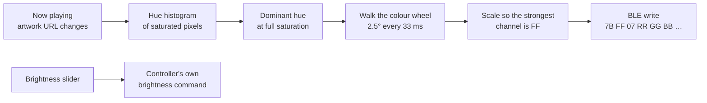

- **Picking the colour.** The artwork's saturated pixels are binned by hue, each bin scored together
  with its neighbours so a colour split across a bin edge isn't undercounted. Covers with under ~3%
  colourful pixels (black-and-white art) get a warm white instead of noise.
- **Full saturation, always.** On a strip, a third channel is *added white light*, not depth: a red
  cover read as `FF 07 24` looked pink. `FF 00 00` is the red it should be.
- **Walking, not jumping.** Song changes move around the colour wheel the short way, in fixed steps
  (half the wheel in ~2.4 s). Fixed steps instead of a timed fade mean a slow Bluetooth write slows
  the walk down rather than making it jump to catch up. A new song mid-walk simply carries on from
  wherever the strip is.
- **White that eases in.** Saturation moves in perceptual steps (whiteness1/2.2): stepped
  linearly, a colour → white walk read as a jump at the start, because the eye sees the first few
  percent of added white, especially the strip's strong blue, as most of the change.

### What the hardware taught me

These came from testing the controller from a laptop before writing any app code:

- 🔆 **It flickers on mid-range values.** The same yellow → white fade flickered at both 30 and 8
  writes/s whenever its strongest channel sat around `7A`, and was smooth at both rates with it
  held at `FF`. So every colour is sent at full value, and brightness is the controller's own command.
- 🌑 **Brightness byte `00` makes it jump *bright*.** The floor is 4% (byte `01`).
- 🎚️ **It has 32 coarse brightness levels and no fade of its own.** A "fade through dark" between songs
  looked stepped, so I built it, tested it, and removed it.

The LED setting lives inside **Car mode** (below), under Developer options on Android, with a live swatch
of what the strip is showing and a scanner that lists `LEDDMX` controllers nearest-first.

 

## 📱↔️📱 Continue on the other phone

I switch between two phones. Now whichever one I pick up opens on the song the other was playing,
at the same spot.

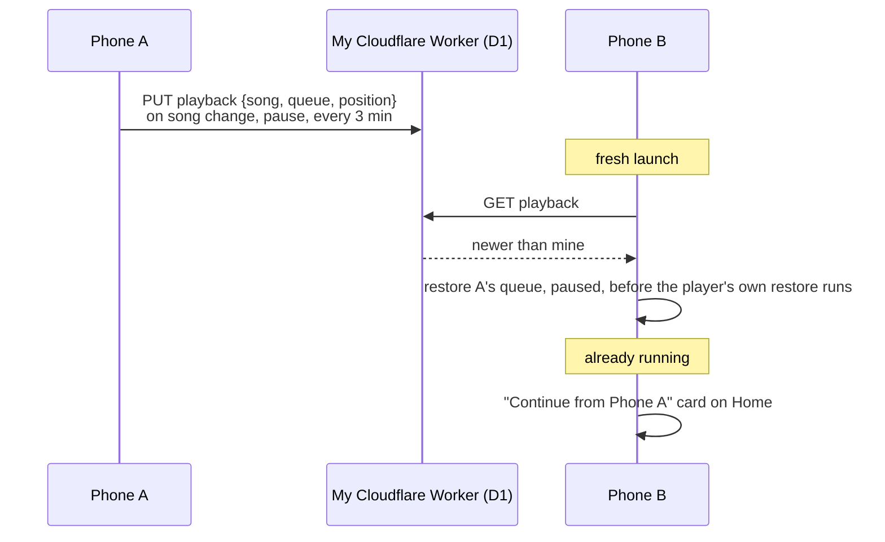

- **My own server, a tiny one.** A ~50-line Cloudflare Worker storing blobs in **D1**. Not KV: KV
  allows 1,000 writes a day on the free plan and can serve a stale value for up to 60 s elsewhere;
  D1 is strongly consistent and allows 100k writes a day. The bearer key is checked in **constant time**.
- **A launch-restore gate** in `core` lets the app write the other phone's newer queue to where the
  player's restore reads it, *before* that restore runs (waiting at most 4 s).

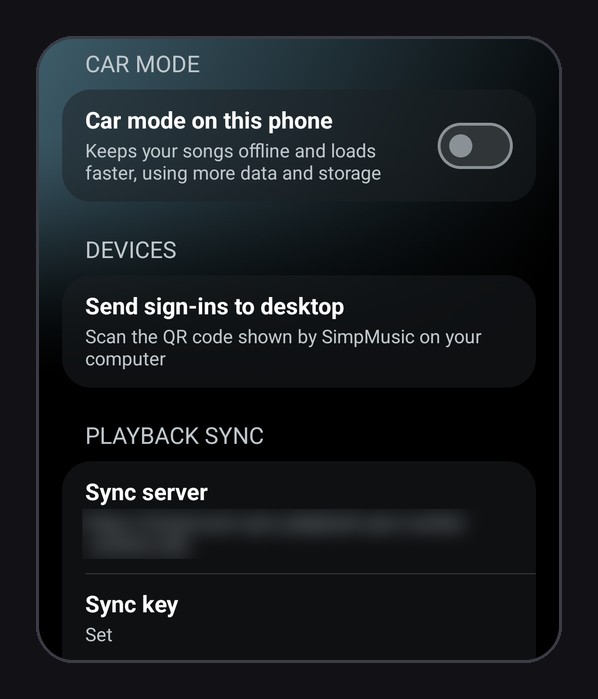

### Sign-ins and the AI key, end-to-end encrypted

The same Worker carries my sign-ins (YouTube, Spotify, Discord, Last.fm) and the AI translation key,
so a new install signs itself in:

- Sealed with **AES-256-GCM** under a key derived from the sync key, so the server only ever stores ciphertext
- **Newest wins, and sync only adds.** A sign-out or a cleared key stays on its own device; a blank never overwrites a filled-in value
- **Nothing uploads until the first pull answers**, so a fresh install or an offline phone can't overwrite good settings with empty ones
- **AI-translated lyrics are shared too**: a song translated on one phone isn't paid for again on the other
- Per-song lyric fixes and my own timed lyrics sync the same way, one record per song. A phone without
  my lyrics can't erase them elsewhere: a removal has to be stated outright, and an overwritten file keeps a `.bak` copy

 

## 🎛️ A player rebuilt for Samsung DeX

- **Grows out of the mini player**, YouTube Music style: drag the bar up and the player follows your
  finger, the bar's glass carried over and the cover flying to its place; release to open or sink back
- **Decluttered** for a desktop-sized screen: no volume row, output capsule or bitrate line;
  play/pause right on the Lyrics and Queue headers
- **Pages slide like a carousel**, by tab order, instead of every transition sliding in from the left
- **Wide windows** (DeX, tablets, landscape, from 840 dp): the mini player sits *beside* the tabs and
  search, capped at 560 dp, and re-centres as the tabs fold
- Small things that add up: the mini bar's cover and title are a pager over the queue, tapping the
  song that's already loaded opens it instead of restarting it, and a 16:9 video thumbnail no longer
  jumps shape when the player closes. The close spring also settles within 0.02% instead of 1%, which
  used to snap the last ~20 px.

 

## ⚡ Faster starts, and a crossfade you can see

**Tap to audio, about twice as fast** (on a phone, signed in, itag 141):

| Network | Before | After |
| :--- | ---: | ---: |
| Wi-Fi | 3.10 s | 1.29 s |
| Mobile data | 4.40 s | 2.12 s |

- The Tidal search for BPM and key now runs in the background instead of holding up the stream; crossfade asks again when a fade is due
- The extractor starts alongside the WEB_REMIX request, and a music video's audio and video sources share one extraction
- Dropped a HEAD check that repeated the extractor's own

**The two-cover crossfade**, in the Apple Music style player: while two songs blend, the old and new
covers sit side by side with glowing particles flowing between them in each cover's colours. When the
fade ends, the new cover grows back into the full artwork. The "Crossfading" label is now a word picked
per fade (Mixing, Cooking, ...).

 

## ⚙️ Settings and Home

- **Settings is now pages**: a main page of six categories plus Developer options, each opening its own page and sliding like the rest of the app. Desktop shows the list and the page side by side
- **Style pickers show real screenshots**: Now Playing style and Lyrics style open pages of them, and a tap applies one
- **Choices apply on tap**: pick-one and pick-several settings open a popup that stays open, and long lists get an accent-insensitive search
- **Names instead of codes**: country shows its flag and full name, and translation and subtitle languages are picked by name instead of typed as a code
- **A dial for lyrics timing**: the offset large, -/+10 ms buttons, a ±2 s slider and Reset
- **Vietnamese throughout**: the 119 strings of the fork's own features that were still English
- **Home's song shelves are found by shape, not title**: YouTube names the Quick picks shelf differently from load to load, so matching the title made its grid come and go. Now every all-songs shelf with 4 rows gets the grid, in every language

 

## 🎤 Lyrics

<table>
<tr>
<td width="38%" align="center">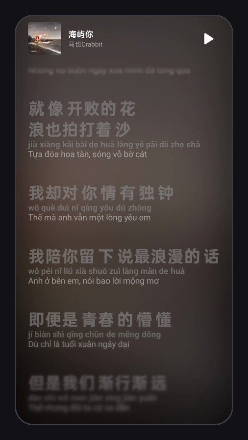</td>
<td>

A Chinese song, read three ways: the original, its **pinyin** (which in my fork lights up word by word
with the singer), and a **Vietnamese translation** from my rewritten prompt, written to be sung rather than word-for-word.

*就像开败的花 浪也拍打着沙* 
*jiù xiàng kāi bài de huā làng yě pāi dǎ zhe shā* 
*Tựa đóa hoa tàn, sóng vỗ bờ cát*

</td>
</tr>
</table>

- **AI translation was silently broken**: the default Gemini model (`gemini-2.0-flash`) had been
  retired, so every request failed. Moved to `gemini-2.5-flash`, with a prompt asking for natural,
  singable Vietnamese lines in one consistent voice; translations are cached per prompt version, so
  old ones are redone once
- **Romanized readings** (pinyin and the like) light up **word by word** with the original line
- **Progressive blur** over the bottom third of the lyrics, clear toward the edge
- **Tap along**: the song restarts and each tap stamps the highlighted line, minus the lyrics offset
  and a 250 ms reaction time. Lines can be edited, added or deleted while listening; the result wins
  over every provider for that song
- **Fixed a Spotify matching bug** in `core`: the search compared milliseconds against seconds, so no
  track ever matched and the top hit was taken, usually the *original* song for a remix, with the
  original's timing. Lyrics and canvas now match within 5 s
- **"No lyrics" per song**, for songs every provider gets wrong. It syncs between devices, and my own timed lyrics still win over it
- A provider returning plain lyrics no longer ends the lookup: the chain keeps looking for a timed
  version first

 

## 🚙 Car mode

A per-device switch for the phone that lives in the car:

- **An offline library** that fills itself: liked songs plus a 10 GB pool of my top 500 and every
  song heard to 80%, seeded once from play history. Over budget, the least-played and longest-ago go
  first. Covers and lyrics download with each song
- **Whole-song preloads** and a 2 GB, 30-day cover cache for patchy signal on the road
- Launch doesn't wait for playback sync

And for weak networks generally, in `core`: Home's four requests now wait for the stored session to
reach the YouTube client instead of racing it; Home loads once per launch (it used to restart up to
five times) and shows each part as it arrives; the YouTube client retries on I/O errors; and the
player's cipher script is cached on disk.

 

## 📦 Shipping it to my own phones

- **`bao-` releases** on the fork: a script builds and publishes one, and **refuses uncommitted or
  unpushed work**, so the APK always matches its tag
- **One link that never goes stale**: every release carries the arm64 APK under a fixed name, so
  [the download button](https://github.com/baotrq/simpmusic-bao-showcase/releases/latest/download/SimpMusic-Bao.apk) always gets the newest
- **In-app updates**: *Check for new build* in Settings → About compares the build's baked-in commit time
  with the newest `bao-` release and hands the APK to the system installer. Nothing checks at launch, so
  startup doesn't spend a weak connection on it
- **One signing key on every machine**: the script refuses to publish without it, so any build can update any phone
- Versioned **2.5.0.x**: upstream's release plus a fork rebuild number, so it's always clear which
  upstream it tracks. The upstream update check still points at upstream's releases
- **Upstream 2.5.0 merged**, keeping what's mine where the two collided: my Home header and shelf order, and my
  Apple Music style player with upstream's like button added

<b>An experiment I reverted: AutoMix</b>

 

With crossfade on Auto, each time a radio track started I weighed the next five against it by
**BPM gap and Camelot-wheel key distance** (from Tidal metadata) and moved the best fit to play next.
I reverted it the same day; it's kept in the history as an experiment.

 

## 🗓️ Timeline

| Day | What landed |
| :--- | :--- |
| **Oct 12** | Decluttered the player for DeX; personal build identity (`.bao` package, own name) |
| **Oct 13** | Gestures and lyric browsing, the player growing out of the mini bar, carousel transitions, AI translation fix, progressive blur, trimmed Settings |
| **Oct 14** | 💡 **LED strip sync**, continue on the other phone, encrypted sign-in sync, in-app updates, wide-window bar, glass polish |
| **Oct 16** | Per-song lyrics, tap-along, merged song + video search; AutoMix tried and reverted |
| **Oct 17** | Car mode with the offline library; faster launch on weak networks |
| **Oct 31** | Two-cover crossfade, safer lyrics sync, "No lyrics" per song |
| **Nov 2** | Merged upstream 2.5.0 |
| **Nov 3** | Settings split into pages, style previews, Vietnamese for the fork's own features |
| **Nov 4** | Choice popups, country and language names, offset dial, Quick picks grid by shape |
| **Nov 6** | ⚡ New songs start about twice as fast |

| 📝 39 commits | ➕ ~13.4k lines added | 📦 15 `bao-` releases |
| :---: | :---: | :---: |

 

---

Fork changes by **[Bảo Trương](https://github.com/baotrq)** · SimpMusic © [maxrave-dev](https://github.com/maxrave-dev/SimpMusic) and contributors, GPL-3.0

