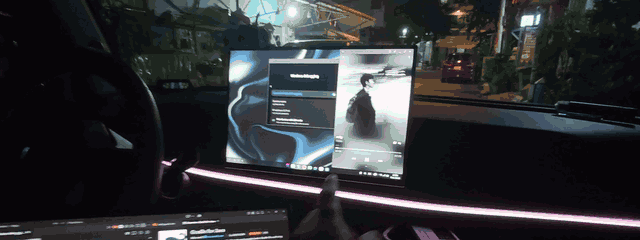
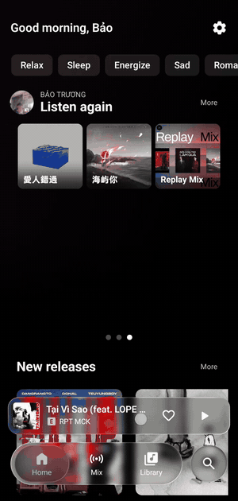
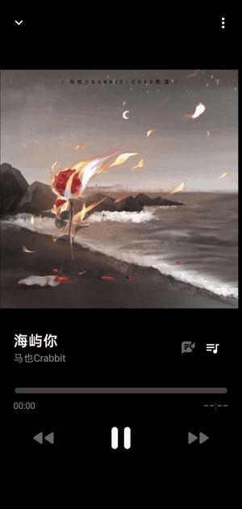
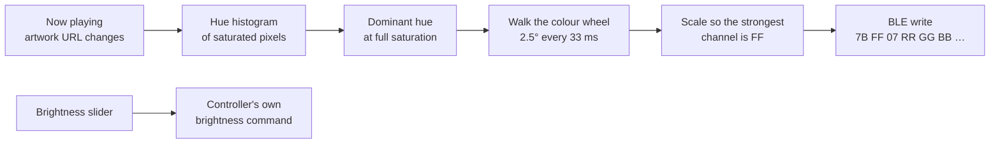
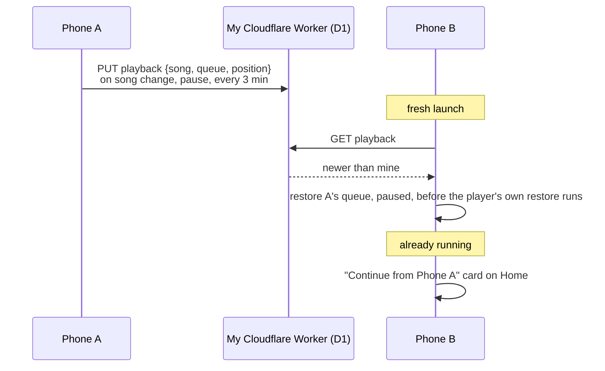
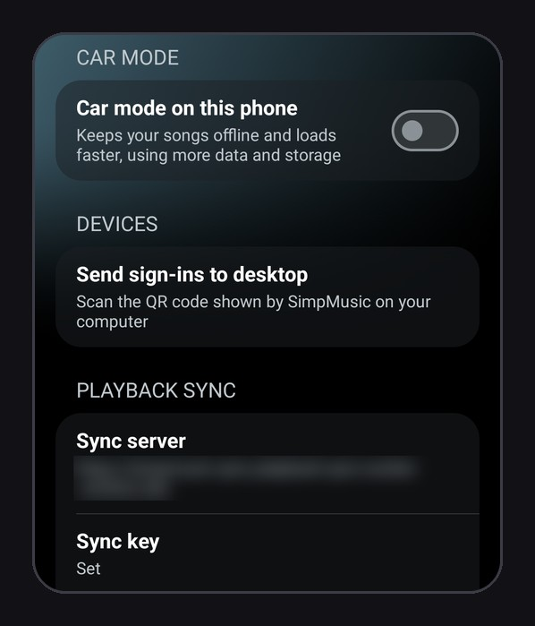
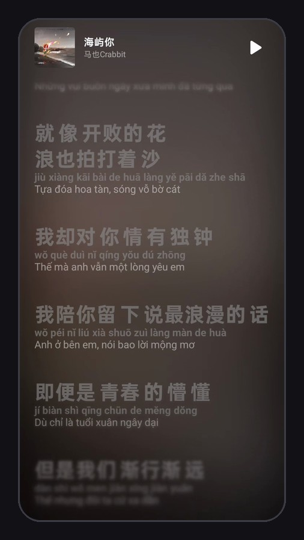

# SimpMusic (Bao)

**My daily-driver build of [SimpMusic](https://github.com/maxrave-dev/SimpMusic).**
A car LED strip that follows the album art, music that follows me from phone to phone,
and a player rebuilt for Samsung DeX.

 

> [!NOTE]
> **SimpMusic** is a FOSS YouTube Music client by [maxrave-dev](https://github.com/maxrave-dev) and its contributors (GPL-3.0).
> This page shows only **what I changed in my fork**: 26 commits across the app and its `core` module, October 12–17, 2026.
> All of the fork's code is public in [baotrq/SimpMusic](https://github.com/baotrq/SimpMusic/tree/main) and [baotrq/core](https://github.com/baotrq/core/tree/bao/ai-translation).

Real footage: the dash strip goes white for a black-and-white cover, then pink, red and blue as the covers change.

<table>
<tr>
<td width="33%" align="center"> <b>Grows out of the mini bar</b></td>
<td width="33%" align="center"> <b>Swipe between songs</b></td>
<td width="33%" align="center"> <b>Romanized + translated lyrics</b></td>
</tr>
</table>

Screen recordings from my phone.

 

## ✨ What you get

SimpMusic is already a great app; my fork builds on top of it. To be clear about who made what:

<table>
<tr>
<th width="50%">From SimpMusic (upstream)</th>
<th width="50%">Added in my fork</th>
</tr>
<tr>
<td valign="top">

- 🎧 **The whole YouTube Music catalogue, ad-free**, with background playback
- 🔊 **Full audio quality**: pick the stream quality, or prefer a 320 kbps stream where one exists
- 🫧 **Liquid glass** bottom bar and mini player
- 🎤 **Synced lyrics** from several providers, plus AI lyric translation
- 🎬 **Spotify Canvas** and animated album covers behind the player
- ⏭️ SponsorBlock, AutoEq, downloads, and a desktop app

</td>
<td valign="top">

- 💡 **Car LED strip** that follows the album art
- 📱 **Continue on the other phone**, with end-to-end-encrypted sign-in sync
- 🎞️ **Animations**: the player grows out of the mini bar, carousel page transitions, a song pager in the bar
- 🈶 **Romanized lyrics light up word by word** (pinyin and more), and AI translations that are **natural and singable**
- ✍️ **Tap-along** to time your own lyrics, and per-song lyric sources
- 🖥️ A layout for **Samsung DeX** and wide screens
- 🚙 **Car mode** with a self-filling offline library

</td>
</tr>
</table>

 

## 🚗💡 The car LED strip follows the music

My car has a cheap Bluetooth LED strip. Now, every time a song changes, the strip glides to the
colour of that song's album art: red cover, red cabin; blue cover, blue cabin.

### Reverse-engineering the controller

The strip's controller (`LEDDMX-…`) only talks to its own app, *LED LAMP*, with no documented
protocol. So I turned on Android's **Bluetooth HCI snoop log**, drove the official app, and read
the packets back:

| Command | Bytes (write-without-response to `FFE1` on service `FFE0`) |
| :--- | :--- |
| Handshake (sent once after connecting) | `2A 02 A1 23 45 67 56 02 AF` |
| Colour | `7B FF 07 RR GG BB 00 FF BF` |
| Brightness | `7B FF 01 LL PP 00 FF FF BF` |
| Power | `7B FF 04 0x FF FF FF FF BF` |

The app connects alongside *LED LAMP*, so neither one has to be closed for the other.

### From album art to light

- **Picking the colour.** The artwork's saturated pixels are binned by hue, each bin scored together
  with its neighbours so a colour split across a bin edge isn't undercounted. Covers with under ~3%
  colourful pixels (black-and-white art) get a warm white instead of noise.
- **Full saturation, always.** On a strip, a third channel is *added white light*, not depth: a red
  cover read as `FF 07 24` looked pink. `FF 00 00` is the red it should be.
- **Walking, not jumping.** Song changes move around the colour wheel the short way, in fixed steps
  (half the wheel in ~2.4 s). Fixed steps instead of a timed fade mean a slow Bluetooth write slows
  the walk down rather than making it jump to catch up. A new song mid-walk simply carries on from
  wherever the strip is.
- **White that eases in.** Saturation moves in perceptual steps (whiteness1/2.2): stepped
  linearly, a colour → white walk read as a jump at the start, because the eye sees the first few
  percent of added white, especially the strip's strong blue, as most of the change.

### What the hardware taught me

These came from testing the controller from a laptop before writing any app code:

- 🔆 **It flickers on mid-range values.** The same yellow → white fade flickered at both 30 and 8
  writes/s whenever its strongest channel sat around `7A`, and was smooth at both rates with it
  held at `FF`. So every colour is sent at full value, and brightness is the controller's own command.
- 🌑 **Brightness byte `00` makes it jump *bright*.** The floor is 4% (byte `01`).
- 🎚️ **It has 32 coarse brightness levels and no fade of its own.** A "fade through dark" between songs
  looked stepped, so I built it, tested it, and removed it.

The LED setting lives inside **Car mode** (below), first in Settings on Android, with a live swatch
of what the strip is showing and a scanner that lists `LEDDMX` controllers nearest-first.

 

## 📱↔️📱 Continue on the other phone

I switch between two phones. Now whichever one I pick up opens on the song the other was playing,
at the same spot.

- **My own server, a tiny one.** A ~50-line Cloudflare Worker storing blobs in **D1**. Not KV: KV
  allows 1,000 writes a day on the free plan and can serve a stale value for up to 60 s elsewhere;
  D1 is strongly consistent and allows 100k writes a day. The bearer key is checked in **constant time**.
- **A launch-restore gate** in `core` lets the app write the other phone's newer queue to where the
  player's restore reads it, *before* that restore runs (waiting at most 4 s).

### Sign-ins and the AI key, end-to-end encrypted

The same Worker carries my sign-ins (YouTube, Spotify, Discord, Last.fm) and the AI translation key,
so a new install signs itself in:

- Sealed with **AES-256-GCM** under a key derived from the sync key, so the server only ever stores ciphertext
- **Newest wins, and sync only adds.** A sign-out or a cleared key stays on its own device; a blank never overwrites a filled-in value
- **Nothing uploads until the first pull answers**, so a fresh install or an offline phone can't overwrite good settings with empty ones
- **AI-translated lyrics are shared too**: a song translated on one phone isn't paid for again on the other
- Per-song lyric fixes and my own timed lyrics sync the same way, one record per song

 

## 🎛️ A player rebuilt for Samsung DeX

- **Grows out of the mini player**, YouTube Music style: drag the bar up and the player follows your
  finger, the bar's glass carried over and the cover flying to its place; release to open or sink back
- **Decluttered** for a desktop-sized screen: no volume row, output capsule or bitrate line;
  play/pause right on the Lyrics and Queue headers
- **Pages slide like a carousel**, by tab order, instead of every transition sliding in from the left
- **Wide windows** (DeX, tablets, landscape, from 840 dp): the mini player sits *beside* the tabs and
  search, capped at 560 dp, and re-centres as the tabs fold
- Small things that add up: the mini bar's cover and title are a pager over the queue, tapping the
  song that's already loaded opens it instead of restarting it, and a 16:9 video thumbnail no longer
  jumps shape when the player closes. The close spring also settles within 0.02% instead of 1%, which
  used to snap the last ~20 px.

 

## 🎤 Lyrics

<table>
<tr>
<td width="38%" align="center"></td>
<td>

A Chinese song, read three ways: the original, its **pinyin** (which in my fork lights up word by word
with the singer), and a **Vietnamese translation** from my rewritten prompt, written to be sung rather than word-for-word.

*就像开败的花 浪也拍打着沙* 
*jiù xiàng kāi bài de huā làng yě pāi dǎ zhe shā* 
*Tựa đóa hoa tàn, sóng vỗ bờ cát*

</td>
</tr>
</table>

- **AI translation was silently broken**: the default Gemini model (`gemini-2.0-flash`) had been
  retired, so every request failed. Moved to `gemini-2.5-flash`, with a prompt asking for natural,
  singable Vietnamese lines in one consistent voice; translations are cached per prompt version, so
  old ones are redone once
- **Romanized readings** (pinyin and the like) light up **word by word** with the original line
- **Progressive blur** over the bottom third of the lyrics, clear toward the edge
- **Tap along**: the song restarts and each tap stamps the highlighted line, minus the lyrics offset
  and a 250 ms reaction time. Lines can be edited, added or deleted while listening; the result wins
  over every provider for that song
- **Fixed a Spotify matching bug** in `core`: the search compared milliseconds against seconds, so no
  track ever matched and the top hit was taken, usually the *original* song for a remix, with the
  original's timing. Lyrics and canvas now match within 5 s
- A provider returning plain lyrics no longer ends the lookup: the chain keeps looking for a timed
  version first

 

## 🚙 Car mode

A per-device switch for the phone that lives in the car:

- **An offline library** that fills itself: liked songs plus a 10 GB pool of my top 500 and every
  song heard to 80%, seeded once from play history. Over budget, the least-played and longest-ago go
  first. Covers and lyrics download with each song
- **Whole-song preloads** and a 2 GB, 30-day cover cache for patchy signal on the road
- Launch doesn't wait for playback sync

And for weak networks generally, in `core`: Home's four requests now wait for the stored session to
reach the YouTube client instead of racing it; Home loads once per launch (it used to restart up to
five times) and shows each part as it arrives; the YouTube client retries on I/O errors; and the
player's cipher script is cached on disk.

 

## 📦 Shipping it to my own phones

- **`bao-` releases** on the fork: a script builds and publishes one, and **refuses uncommitted or
  unpushed work**, so the APK always matches its tag
- **In-app updates**: the build compares its own baked-in commit time with the newest `bao-` release
  and hands the APK to the system installer
- Versioned **2.3.0.x**: upstream's release plus a fork rebuild number, so it's always clear which
  upstream it tracks. The upstream update check still points at upstream's releases

<b>An experiment I reverted: AutoMix</b>

 

With crossfade on Auto, each time a radio track started I weighed the next five against it by
**BPM gap and Camelot-wheel key distance** (from Tidal metadata) and moved the best fit to play next.
I reverted it the same day; it's kept in the history as an experiment.

 

## 🗓️ Six days

| Day | What landed |
| :--- | :--- |
| **Oct 12** | Decluttered the player for DeX; personal build identity (`.bao` package, own name) |
| **Oct 13** | Gestures and lyric browsing, the player growing out of the mini bar, carousel transitions, AI translation fix, progressive blur, trimmed Settings |
| **Oct 14** | 💡 **LED strip sync**, continue on the other phone, encrypted sign-in sync, in-app updates, wide-window bar, glass polish |
| **Oct 16** | Per-song lyrics, tap-along, merged song + video search; AutoMix tried and reverted |
| **Oct 17** | Car mode with the offline library; faster launch on weak networks |

| 📝 26 commits | ➕ ~9.1k lines added | 🌿 9 feature branches | 📦 9 `bao-` releases |
| :---: | :---: | :---: | :---: |

 

---

Fork changes by **[Bảo Trương](https://github.com/baotrq)** · SimpMusic © [maxrave-dev](https://github.com/maxrave-dev/SimpMusic) and contributors, GPL-3.0

